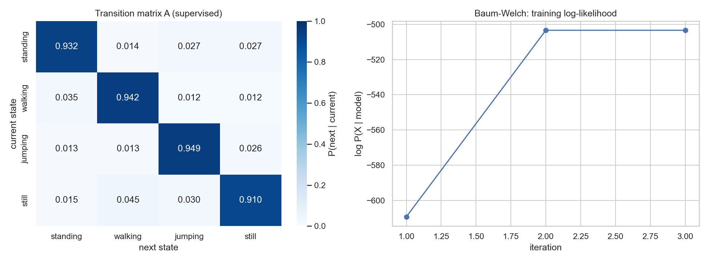
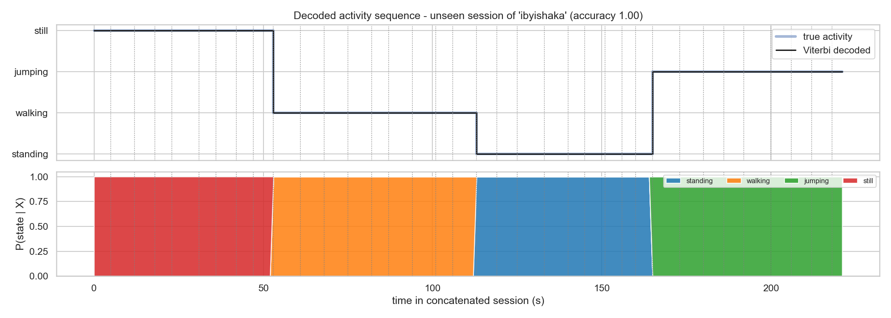

# Human Activity Recognition with a Hidden Markov Model

A Hidden Markov Model (HMM), implemented from scratch in NumPy, that infers what a person is doing (**standing, walking, jumping** or **still**) from smartphone accelerometer and gyroscope signals.

**Use case:** a phone-based "active break" coach for students. It detects long periods of inactivity during study sessions, prompts the student to take a break, and confirms that the break actually happened.

**Author:** IBYISHAKA TRESOR Thierry Alain (individual project)

---

## Results at a glance

Evaluated on **36 held-out recordings (222 windows)** that were never used for training:

| State (Activity) | Recordings | Number of Samples (windows) | Sensitivity | Specificity | Overall Accuracy |
|---|---|---|---|---|---|
| Standing | 9 | 52 | 1.000 | 1.000 | 1.000 |
| Walking | 9 | 60 | 1.000 | 1.000 | 1.000 |
| Jumping | 9 | 57 | 1.000 | 1.000 | 1.000 |
| Still | 9 | 53 | 1.000 | 1.000 | 1.000 |

- **Training accuracy:** 99.7%. Only 1 of 289 windows was wrong: the last window of one standing recording, decoded as walking.
- **Sampling rate:** accuracy stays at 100% even when the signals are downsampled to 25 Hz and 10 Hz.
- **Noise:** added sensor noise mainly confuses *still* with *standing*, the hardest pair to separate.
- **Limitation:** the held-out recordings come from the same day, place and person as the training data, so the perfect score is optimistic. See the report for the full discussion.

| Transition matrix | Decoded unseen sequence |
|---|---|
|  |  |

---

## Dataset

| | |
|---|---|
| Participant | 1 (individual project) |
| Phone / app | Samsung SM-A5260 (Android 14), Sensor Logger 1.68 |
| Sensors | Accelerometer (x, y, z, m/s², gravity removed) and gyroscope (x, y, z, rad/s) |
| Sampling rate | 100 Hz requested, **52.9 Hz delivered** by the phone for both sensors, **harmonised to 50 Hz** |
| Phone position | Held against the front of the waist, screen facing out; flat on a table for *still* |
| Recordings | 83 in total, 6 to 18 s each, one activity per file |

| Split | Standing | Walking | Jumping | Still | Total |
|---|---|---|---|---|---|
| Train | 12 | 12 | 12 | 11 | 47 |
| Unseen (test) | 9 | 9 | 9 | 9 | 36 |

- **Raw data** (`data/raw/`): the original Sensor Logger export zips, one per recording, kept unmodified. The folder name is the activity label.
- **Processed data** (`data/processed/`): one labelled CSV per recording, named `ibyishaka_<activity>_<nn>.csv`, with columns `timestamp`, `datetime` (UTC), `t`, `acc_x, acc_y, acc_z`, `gyro_x, gyro_y, gyro_z`, `activity`, `member`, `recording_id`. Each folder also has a `_recordings.csv` index listing every recording's source file, duration and measured sampling rate.

The links to the data-collection videos (one per activity) are in the report.

---

## Method

1. **Pre-processing.** Each zip is read directly. 0.5 s is trimmed from each end of the recording. Both sensors go through the same 20 Hz low-pass filter and are then interpolated onto one shared 50 Hz grid, which aligns them and harmonises the sampling rate.
2. **Features.** The signals are cut into 2 s windows with a 1 s step. Each window gives 17 features per sensor (34 in total):
   - **Time domain:** per-axis mean and standard deviation, magnitude mean and variance, signal magnitude area, and correlation between axes.
   - **Frequency domain (FFT):** dominant frequency, spectral energy, and the share of energy in the 0.3-1.5, 1.5-3 and 3-6 Hz bands.
3. **HMM.**

   | Component | Definition |
   |---|---|
   | Hidden states | standing, walking, jumping, still |
   | Observations | z-scored feature vectors |
   | Emissions | Gaussian with diagonal covariance |
   | Transitions **A** and initial probabilities **π** | estimated by counting, with Laplace smoothing |

4. **Algorithms (NumPy only, in log space).**
   - **Training:** supervised maximum likelihood.
   - **Decoding:** Viterbi.
   - **Likelihood:** forward-backward, used for likelihoods and posterior decoding.
   - **Baum-Welch (EM):** run as a refinement experiment.
   - **Checks:** the implementation is verified on data sampled from a known 2-state HMM, and the results are compared against a baseline without transitions.

---

## Repository structure

```text
data/
  raw/
    train/<activity>/          47 Sensor Logger zips (training)
    unseen/<activity>/         36 Sensor Logger zips (test only)
  processed/
    train/, unseen/            harmonised 50 Hz labelled CSVs + _recordings.csv index
hmm_activity_recognition.ipynb pipeline: pre-processing, features, HMM, evaluation, plots
results/
  figures/                     transition heatmap, decoded sequence, confusion matrix, features, experiments
  evaluation_table.md          sensitivity / specificity / accuracy table
  sampling_rates.csv           measured sampling rate per activity
  window_features.csv          all window features
requirements.txt               Python dependencies
```

---

## How to run

Requires Python 3.10 or newer.

```bash
pip install -r requirements.txt
jupyter lab hmm_activity_recognition.ipynb
```

Then run all cells (in VS Code: select a Python kernel, then **Run All**). A full run takes under a minute on a laptop. It regenerates `data/processed/` and `results/` from the raw zips.

**To add recordings:** export them from Sensor Logger as CSV, put the `.zip` (not unzipped) in `data/raw/<train|unseen>/<activity>/`, and run the notebook again. If `data/raw/unseen/` is empty, the notebook holds out the newest 20% of each activity's training recordings instead, and prints a warning.

---